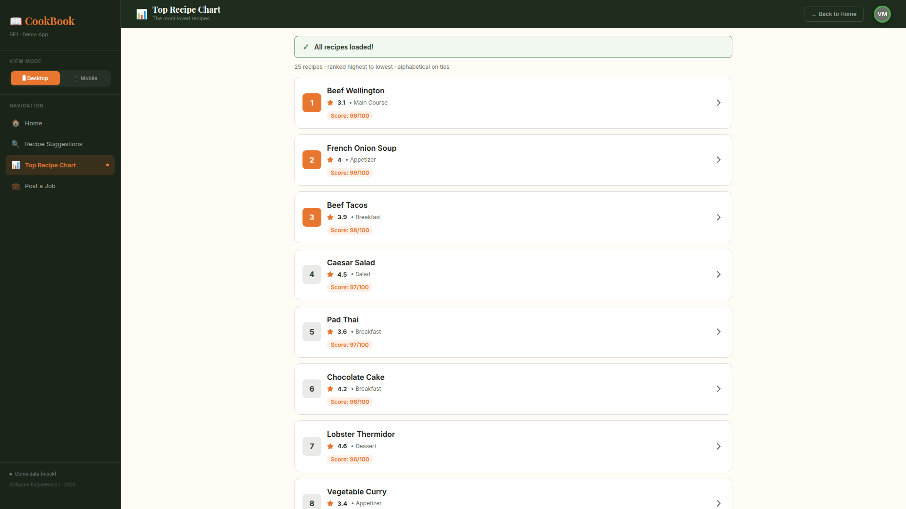
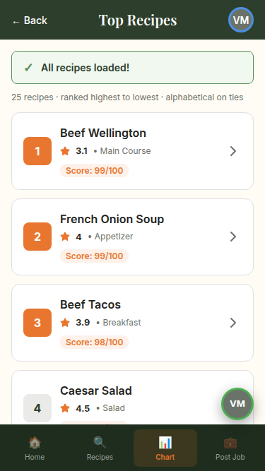
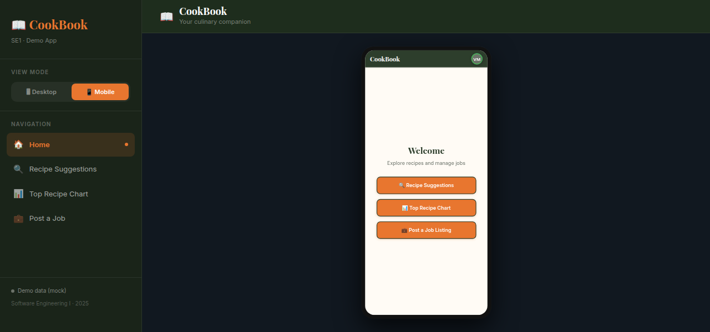

# CookBook

**Software Engineering I & II — course project**

A full-stack prototype of *CookBook*, a recipe and culinary-jobs platform. The app is both a
working UI and a **specification-conformance harness**: each feature can be driven into the exact
state described by a Gherkin scenario from the SRS, so every acceptance criterion can be
demonstrated live rather than described.

It runs against either a deterministic mock data layer (for scenario demos) or a real
SQLite-backed HTTP API.



## What's in the repository

| Layer | What it is |
| --- | --- |
| **Frontend** (`src/`) | React 18 + TypeScript + Vite 6. Three feature screens, a responsive app shell, and a scenario selector. |
| **Data layer** (`src/app/data/`) | Typed `fetch` client and per-resource repositories. `VITE_DATA_SOURCE` selects mock or API. |
| **Backend** (`server/`) | Express 5 with routes → repositories → SQLite. Validation and content policy enforced server-side. |
| **Database** | SQLite via better-sqlite3, versioned SQL migrations applied on startup. **Ships empty** — schema only, no seed data. |
| **Docs** | This README and [`TESTING_INSTRUCTIONS.md`](TESTING_INSTRUCTIONS.md) for the comment-moderation cases. |



## Features

| Feature | Description |
| --- | --- |
| **Recipe Suggestions** | Search recipes by available ingredients and maximum cooking time. Covers every outcome branch: success, time not fulfilled, ingredients not fulfilled, both, and four invalid-input cases. |
| **Top Recipe Chart** | Ranked leaderboard of up to 100 recipes (ranking descending, alphabetical on ties), with load banners for 25 / 100 / 500135 / 0 recipes and a dedicated empty state. |
| **Post a Job Listing** | Job form with validation, draft saving, and account checks (verified / unverified / pending / banned). |
| **Comments** | Attached to recipe details, with posting rules: empty input, banned-word violation, and banned-account rejection. |

## Quick start

Requires **Node 18+** (developed on Node 22) and npm.

```bash
npm install
npm run dev
```

This starts both processes:

```
[api] API listening on http://localhost:3001/api
[api] database: server/data/cookbook.sqlite
[api] migrations: applied 001_init.sql
[web] VITE v6.3.5  ready in ~500 ms
[web] ➜  Local:   http://localhost:5173/
```

Open **http://localhost:5173**.

## Data sources

`VITE_DATA_SOURCE` chooses where the UI reads from.

```bash
npm run dev                       # mock (default) — deterministic data, works offline
VITE_DATA_SOURCE=api npm run dev  # real SQLite API — starts empty, so empty states render
```

| Mode | Behaviour |
| --- | --- |
| `mock` | Scenario harness drives every state from in-memory data. No backend required. |
| `api` | Chart, comments and job posting round-trip to SQLite. Account checks come from the `users` table. |

Copy `.env.example` to `.env` to make a mode the default. In api mode the sidebar footer shows
backend reachability and the current recipe count.

## API

| Method | Path | Notes |
| --- | --- | --- |
| `GET` | `/api/health` | Status and row counts |
| `GET` | `/api/recipes` | Paginated (`limit` ≤ 100), ranked order |
| `GET` | `/api/recipes/:id` | 404 when missing |
| `GET` | `/api/recipes/:id/comments` | Newest first |
| `POST` | `/api/recipes/:id/comments` | 201 · 403 banned account · 422 violation or empty |
| `GET` | `/api/jobs` | Paginated, newest first |
| `POST` | `/api/jobs` | 201 · 403 account checks · 422 missing fields |
| `GET` | `/api/users/:handle` | Account state |

Callers are identified by the `x-user-handle` header (placeholder auth). With an empty database
requests are anonymous.

Example:

```bash
curl -s localhost:3001/api/health
# {"status":"ok","database":"connected","counts":{"recipes":0,"comments":0,"jobs":0,"users":0}}

curl -s -X POST localhost:3001/api/jobs -H 'content-type: application/json' \
  -d '{"title":"Sous Chef","description":"Prep service","location":"Athens",
       "minCompensation":800,"maxCompensation":1200,"employmentType":"Full-time"}'
```

## Demonstrating the scenarios

1. Open a feature from the navigation.
2. Press the **VM** avatar — desktop: top-right of the header; phone: floating button above the tab bar.
3. Pick a scenario and follow the banner.

| Scenario set | Cases |
| --- | --- |
| Job listing | `1` success · `2` missing fields → draft · `3a` unverified · `3b` active ban · `3c` pending review · `3d` unverified + ban |
| Top Recipe Chart | `TC-1` 25 recipes · `TC-2` 100 recipes · `TC-3` 500135 recipes (capped at 100) · `TC-4` 0 recipes |
| Comments | `C-1` no ban → success · `C-2` active ban · `C-3` no ban + banned word |

Banned words: `damn`, `hell`, `crap`, `stupid`, `idiot`, `hate`. Matching is whole-word, so
"shellfish" is **not** flagged. Detailed comment cases are in
[`TESTING_INSTRUCTIONS.md`](TESTING_INSTRUCTIONS.md).

## Responsive behaviour

- **Phones (< 900 px)** — full-bleed layout, bottom tab bar, floating scenario control, safe-area
  padding. No fixed widths; navigation replaces the sidebar.
- **Tablets and desktops** — sidebar shell. Content is centred with a maximum width, and the
  *Mobile* view mode renders the 393 × 852 device frame scaled to fit short windows.
- Verified in headless Chrome at 375×667, 393×852, 667×375 (landscape), 768×1024, 1024×768,
  1440×900, 1920×1080 and 1280×600 (scaled preview): no horizontal overflow, no console errors.



## Project structure

```
server/
├── index.ts                 Express bootstrap, migrations on boot
├── env.ts                   PORT, DB_PATH
├── db/
│   ├── connection.ts        SQLite connection (WAL, foreign keys)
│   ├── migrate.ts           migration runner
│   ├── reset.ts             drop + recreate
│   └── migrations/          001_init.sql
├── domain/                  shared types, content policy
├── repositories/            recipes, comments, jobs, users
└── http/                    router, error handling

src/
├── main.tsx
├── app/
│   ├── App.tsx              shell, navigation, scenario state, responsive layout
│   ├── data/                API client, repositories, data-source config, health hook
│   ├── hooks/useViewport.ts viewport tracking + breakpoint
│   └── components/
│       ├── HomeScreen.tsx
│       ├── RecipeSuggestionsForm.tsx
│       ├── TopRecipeChart.tsx
│       ├── JobListingForm.tsx
│       ├── icons.tsx        inline SVG icons
│       └── recipe/          comment rules, list/detail views, generation, tokens
└── styles/                  fonts, Tailwind entry, theme tokens
```

Business rules stay out of view components: comment outcomes live in `useComments`, recipe
generation in `utils.ts`, shared tokens and data in `constants.ts`.

## Scripts

| Script | Purpose |
| --- | --- |
| `npm run dev` | API + web together |
| `npm run dev:web` / `dev:api` | Run one side only |
| `npm run build` / `preview` | Production build / preview |
| `npm run start:api` | Run the API without watch mode |
| `npm run db:migrate` | Apply pending migrations |
| `npm run db:reset` | Drop and recreate the local database |
| `npm run typecheck` | Type-check client and server |

## Implementation status

| Area | State |
| --- | --- |
| Responsive shell (desktop, tablet, phone) | Implemented |
| Scenario harness (VM selector) | Implemented |
| Comments — rules, server-side enforcement | Implemented |
| Chart list, comments, job posting against SQLite | Implemented (`VITE_DATA_SOURCE=api`) |
| Recipe Suggestions data source | Mock only — uses its own in-memory `RECIPE_DB` |
| Scenario states (bans, verification, counts) | Client-side test doubles, not database state |
| Authentication / sessions | Placeholder header, no real login |
| Recipe creation UI | API and repository only |
| Automated test suite | Not included — verified manually and with scripted browser checks |

## Tech stack

React 18, TypeScript, Vite 6, Express 5, better-sqlite3, Tailwind CSS v4 (layout utilities;
component styling is inline for precise design control). Icons are inline SVG — no icon library.

## Notes

- Views are code-split with `React.lazy`; the home screen loads only the app shell.
- The database is intentionally empty: migrations create `users`, `recipes`, `comments` and
  `job_listings` with foreign keys, check constraints and indexes, but no rows are seeded.
- `server/data/` (the SQLite file) is git-ignored and recreated by `npm run db:reset`.
